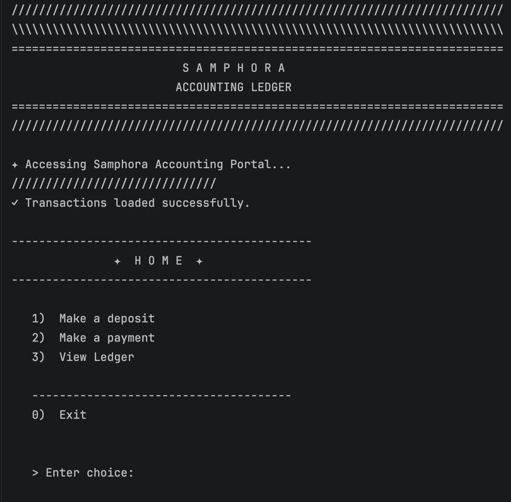
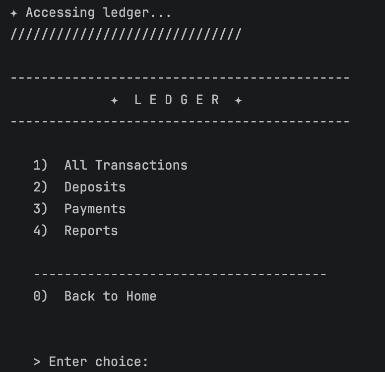
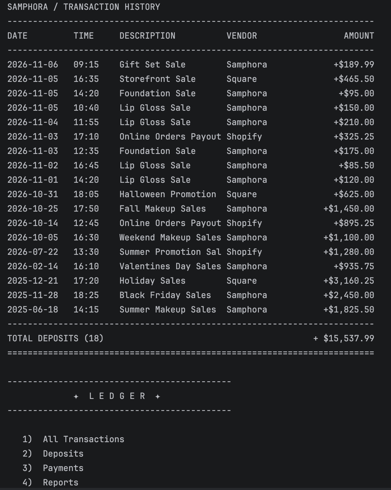
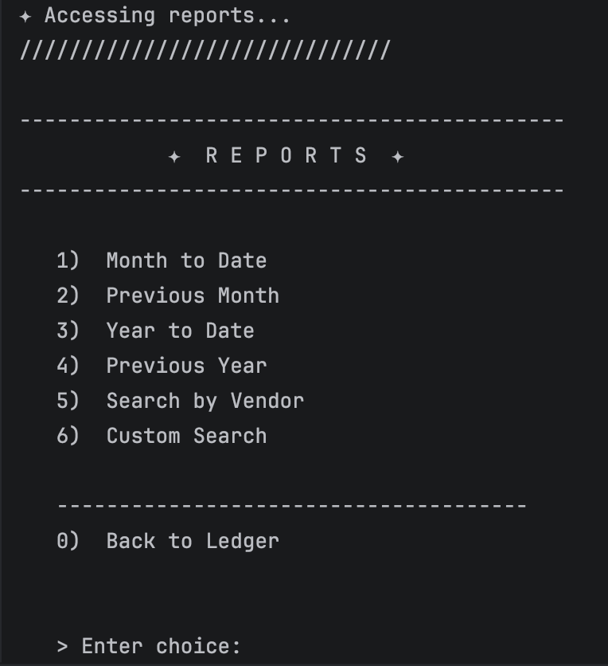
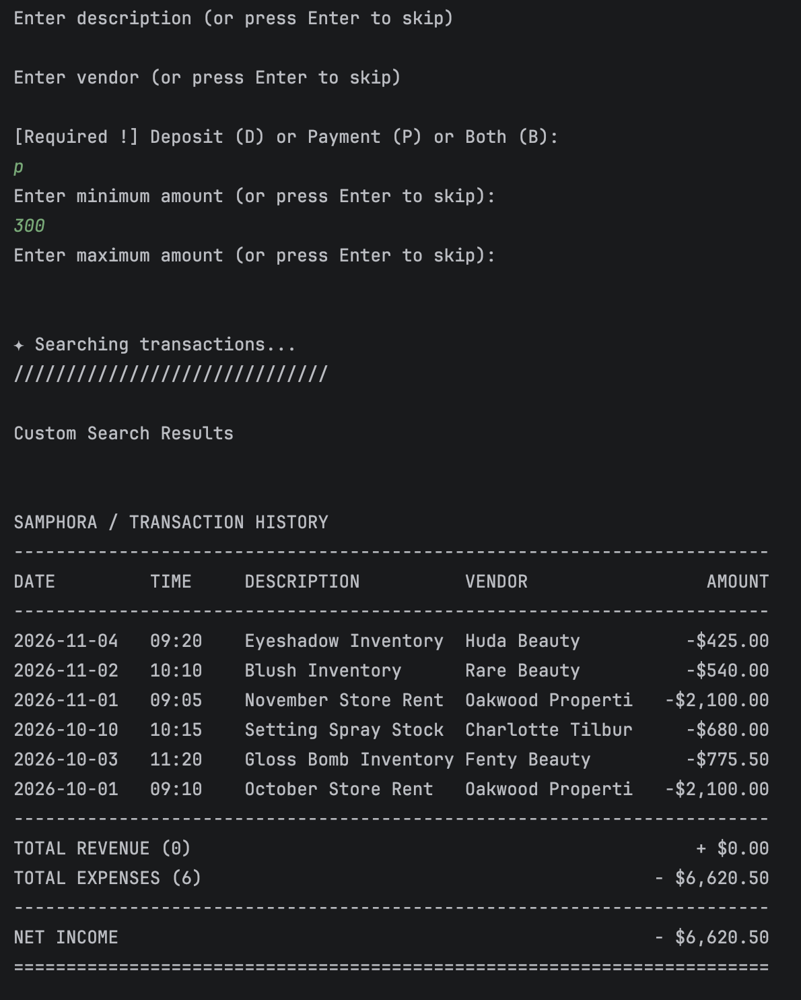
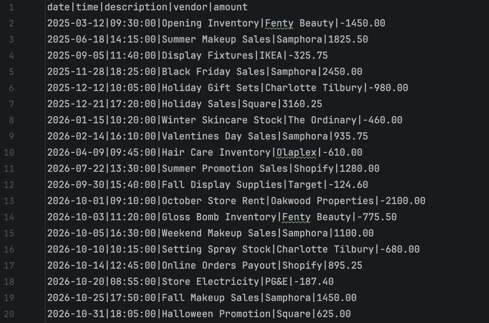

# Samphora Accounting Ledger

> Capstone 1: Accounting Ledger Application  
> Year Up United | Technical Academy Fall 2026

## Description

Samphora is a Java command-line accounting ledger built around a fictional beauty supply store. It records deposits and payments, saves transactions to a file, and lets users review and search their transaction history.

I built this project to practice object-oriented programming, file I/O, collections, date handling, input validation, and organizing code across multiple classes in Java. The console design takes inspiration from Sephora's black-and-white striped branding.

## Key Features

- **Transaction Management:** Add deposits and payments with a description, vendor, amount, and automatically recorded date and time.
- **Transaction History:** View all transactions, deposits only, or payments only, sorted from newest to oldest.
- **Reports:** View month-to-date, previous-month, year-to-date, and previous-year transactions.
- **Vendor Search:** Find transactions by vendor name, including partial matches without case sensitivity.
- **Custom Search:** Filter by start/end date, description, vendor, transaction type, and minimum/maximum amount. Optional fields can be skipped.
- **Financial Summary:** View deposit and payment counts, total revenue, total expenses, and net income for the selected transaction list.
- **CSV File Storage:** Transactions are saved to `Transactions/transactions.csv` and loaded when the program starts. The file uses `|` as its delimiter.
- **Input Validation:** Handles empty required fields, invalid menu choices, invalid dates, and nonpositive or invalid transaction amounts.

## Technologies Used

- Java 17
- IntelliJ IDEA
- Maven
- Git and GitHub

## How to Run

1. Clone the repository:
   ```bash
   git clone https://github.com/sdurani/samphora-accounting-ledger.git
   ```
2. Open the project folder in IntelliJ IDEA.
3. Make sure **JDK 17** is selected for the project.
4. Run `Main.java` in the `com.samphora` package.


## Project Structure

```text
samphora-accounting-ledger/
├── src/
│   └── main/
│       └── java/
│           └── com/
│               └── samphora/
│                   ├── Main.java                # Menus, input, and console display
│                   ├── Transaction.java         # Transaction model
│                   ├── TransactionManager.java  # Transaction storage and CSV handling
│                   └── ReportManager.java       # Report filters and searches
├── Transactions/
│   └── transactions.csv                         # Saved transactions / demo data
└── pom.xml
```

## Screenshots

### Home Screen



### Ledger Screen



### Transaction History and Financial Summary



### Reports Screen



### Custom Search Example



### CSV File Example




## Future Improvements

- **Separate the console screens into their own classes:** Move the Home, Ledger, and Reports methods out of `Main.java`.
- **Add sorting options:** Let users choose ascending or descending order instead of always showing newest first.
- **Simplify input validation:** Create reusable methods for validating dates, amounts, and required fields.

